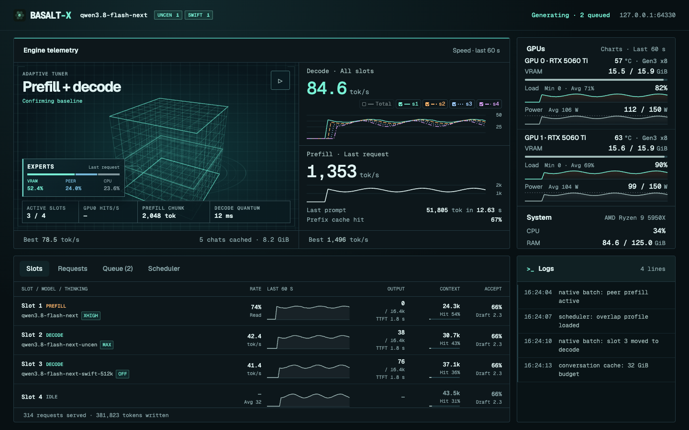

# Basalt-X

Basalt-X is a deployment-oriented fork of [Basalt](https://github.com/jesdga95/basalt) for running Qwen3.8-Flash-Next on NVIDIA Blackwell. Its focus is keeping several agents responsive on one worker, reusing long conversations across turns, and making scheduling decisions visible in the browser.



*The deployed dashboard rendered with synthetic telemetry. The rates shown are illustrative.*

## What Basalt-X adds

Basalt already provides local CUDA inference, CPU-backed expert offload, speculative decoding, an OpenAI- and Anthropic-compatible server, and conversation caching. This branch adds the following on top of upstream commit [`84710728`](https://github.com/jesdga95/basalt/commit/8471072850205167958f474f5898f1a5fb8d8902).

| Area | Additions in Basalt-X |
| --- | --- |
| **Multiple slots** | A shared KV page pool, on-demand logical slots, capacity-aware admission, and slot affinity for long conversations. Compatible short prefill tails can share a verifier window. |
| **Adaptive model names** | Base and 512K context profiles, plus request-scoped Uncen and Swift LoRAs on a shared resident Flash-Next model. |
| **Adaptive scheduling** | Tunable prefill chunk size and decode time budget during overlap, context-aware verifier control, and an online PCIe expert-staging budget. |
| **Long-context KV** | Streamed FP16 or INT8 KV with shared page backing, optional rotated INT8 layouts, prefix checkpoints, RAM parking and recovery. Idle recovery capture yields to pending input. |
| **Two-GPU execution** | Peer-assisted prefill and expert execution, direct FP16 peer results where supported, and experimental overlap of startup transfers and model initialization. |
| **Serving extensions** | A widened Flash-Next reasoning mode, an optional inline batch helper for small tool calls, and an optional CPU speech-to-text path. |
| **Vision** | A separate CPU vision sidecar and an independent encoder arena where supported, with image-cache reuse. |
| **Dashboard** | A redesigned engine view with slot, request and queue panels, decode and prefill rates, model and reasoning labels, expert residency, PCIe telemetry and a Scheduler tab. |

## Multiple slots

Basalt-X can start with one logical slot and add slots when requests arrive. Slots draw pages from one shared KV pool and maintain their own sequence state, position profile and adapter mode. `parallel` seeds the initial slot count. With `shared-kv-pool` enabled, `max-context` sets the worker's total pool and admission checks the requested page reservation. Logical slot count, verifier width and the number of requests the worker can admit are separate limits.

The bridge prefers a compatible warm slot and the native engine validates the matched token prefix before reuse. During a mixed-alias handoff, a short Swift request can use another slot while the previous 512K conversation keeps its KV lease, if both reservations fit. Returning to the 512K alias can then prefill just the new suffix. When the worker cannot fit both leases, admission can queue work or reclaim an idle lease.

Several active requests can share a decode window. With `grouped_short_prefill` enabled, compatible short text prefills or short uncached tails can also use a grouped window when the queue and native reuse checks permit. Longer reads can be interleaved with active decode under the configured overlap policy. Each request keeps its own sampling, output stream and cancellation state.

## Adaptive Model Names

Enable `context-profiles` for Flash-Next to let the model name select the RoPE profile. The base profile uses native RoPE and supports up to **262,144 tokens**. The `-512k` suffix selects **YaRN ×2** and supports up to **524,288 tokens**. Both limits include input and generated output, and each request also has to fit the worker's shared KV budget.

Configure `--atomic-lora` and `--swift-lora` with compatible local adapter files to advertise the corresponding aliases. The deployed catalog uses these names.

| Request model | Context limit | Adapter |
| --- | ---: | --- |
| `qwen3.8-flash-next` | 262,144 | Base |
| `qwen3.8-flash-next-uncen` | 262,144 | AtomicChat / Uncen |
| `qwen3.8-flash-next-swift` | 262,144 | Swift |
| `qwen3.8-flash-next-512k` | 524,288 | Base |
| `qwen3.8-flash-next-uncen-512k` | 524,288 | AtomicChat / Uncen |
| `qwen3.8-flash-next-swift-512k` | 524,288 | Swift |

The aliases share one loaded base model. The bridge translates the requested name into runtime profile and adapter selectors. The engine applies the adapter in the prompt and target verifier paths, supports per-row adapter selection in shared decode, and keys KV by the complete RoPE and adapter combination. Use the same alias across turns to retain compatible KV. Query `GET /v1/models` for the aliases and limits exposed by a specific configuration.

## Adaptive Tuner

The scheduler tracks whether the worker is in solo prefill, overlapping prefill and decode, solo decode, or batch decode. When prefill and decode overlap, it adjusts prompt chunk size and decode time budget against native emission timing, queue pressure and throughput. Overlap trials use stable work and can back off when decode progress deteriorates or the request cohort changes.

The PCIe tuner is enabled by `adaptive_pcie_fraction=1`. At startup, the engine measures host-to-device copy throughput for each participating GPU and for simultaneous transfers. During compatible multi-slot decode it tracks observed copy, compute and completion times for each layer. For the current routed expert misses it estimates the decode window's completion time with and without staging, then stages a whole number of experts when the predicted savings cover the timing margin and the copy fits the byte budget. Two windows with similar token rates can produce different staging fractions because their routed expert work differs.

The normal soft ceiling is **20%**. A layer can exceed it when measured copy and compute leave enough margin. `pcie_tuner_cap` applies an optional hard fractional ceiling. For controlled comparisons, `pcie_tuner_pin_q8` fixes the budget in units of 1/256. A zero fraction can be the best decision for a window when CPU work already finishes off the critical path or PCIe headroom is insufficient.

Open the dashboard's **Scheduler** tab for the current fraction, eligible and staged experts, cumulative staged bytes, startup H2D measurements, and live PCIe RX/TX where available. The physical link ceiling, startup copy measurement and live counters are shown separately because they describe different things.

## Build and run

The deployment was validated on Linux x86-64 with two RTX 5060 Ti cards. The Flash-Next build needs CUDA 13, CMake 3.24 or newer, a supported C++ compiler, and enough host RAM for the model's offloaded experts and KV. See the [upstream platform notes](docs/platforms.md) for toolchain details.

```sh
git clone --branch basalt-x https://github.com/tctien342/basalt-x.git
cd basalt-x
cmake -S . -B build -DCMAKE_BUILD_TYPE=Release -DBASALT_MODELS=qwen4exp
cmake --build build -j
python3 -m pip install -r requirements.txt
```

Obtain a compatible [Flash-Next model pack](https://huggingface.co/jesdga/Qwen3.8-Flash-Next-Basalt) separately. This example starts a basic text worker. Set the model path and GPU index for your machine.

```json
{
  "version": 2,
  "models": [
    {
      "model": "models/Qwen3.8-FN-NVFP4-DQ6_K.basalt",
      "gpu": "0",
      "kv": "int8"
    }
  ],
  "engine": {
    "resident-experts": true
  },
  "server": {
    "port": 8080
  }
}
```

Save this as `basalt_config.json` and start the server.

```sh
bin/basalt serve --config basalt_config.json
```

Open [the local dashboard](http://127.0.0.1:8080/) or query `GET /v1/models`. Enable `shared-kv-pool` or `context-profiles` on the model entry when your streamed KV configuration and memory budget are sized for them. Use the [serving bridge notes](serve/README.md) and [native Flash-Next notes](src/models/qwen4exp/serve/README.md) for feature flags and requirements.

## Credits and license

Basalt-X builds on Jesús Gulfo's [Basalt](https://github.com/jesdga95/basalt) and its upstream projects, including [Strata](https://github.com/Niko1221/Strata), [Infernix](https://github.com/Wallawalla47/Infernix) and [ggml / llama.cpp](https://github.com/ggml-org/llama.cpp). See [LICENSE](LICENSE) and [THIRD_PARTY_LICENSES](THIRD_PARTY_LICENSES). Model packs and LoRA weights follow their own licenses.
